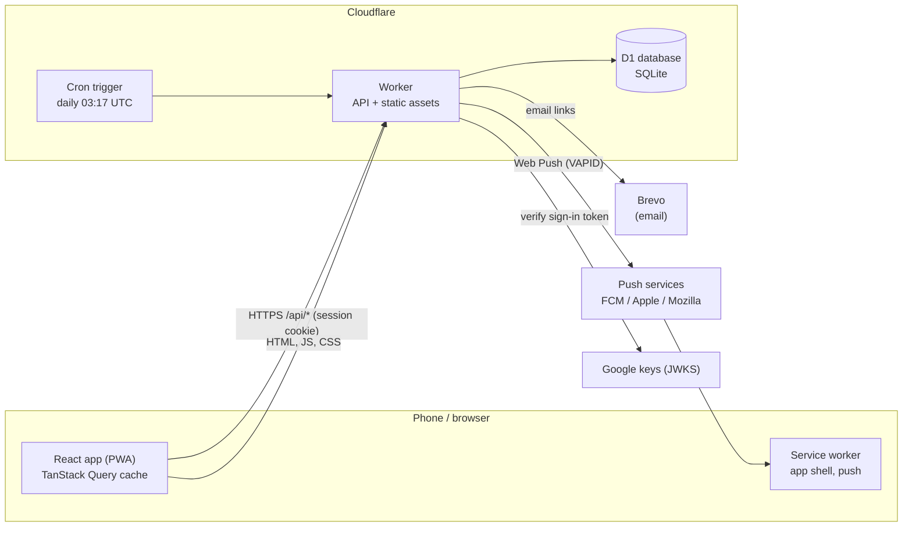
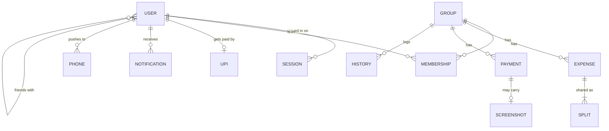
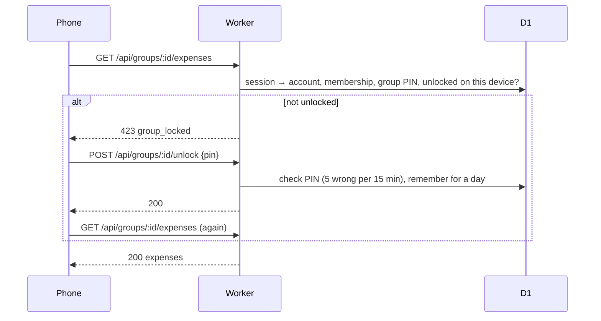
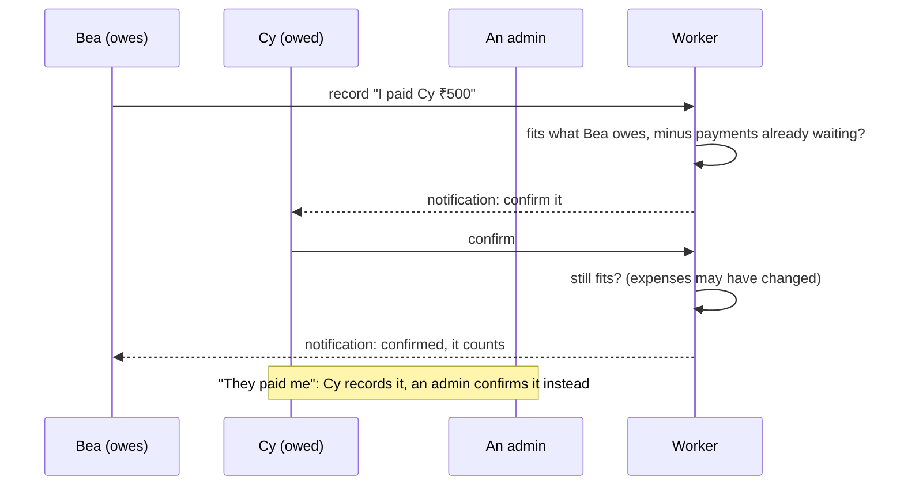

# Split It: high-level design (HLD)

Split It is a free, ad-free web app (installable on phones) for sharing trip and group expenses: who paid, who owes whom, and settling up by UPI. This document describes the system as a whole. The low-level design ([LLD.md](LLD.md)) covers its code: modules, classes, API and schema.

## 1. Scope

**Users.** Friends who travel or live together a few times a year, on phones. A person has one account and can be in any number of groups; groups don't see each other.

**What it does**

| Area | Capabilities |
|---|---|
| Accounts | Sign up with name, username and password (email optional); sign in with username, email or Google; forgot password by email link; profile; merge an old second account |
| Groups | Anyone creates a group and becomes its admin; 4-digit group PIN to join and to open (remembered for a day per device); invite by username or email, by invite link, or by QR; members suggest friends and admins approve; several admins per group |
| Expenses | Equal or exact splits in paise; edit and delete by the payer or an admin; full edit history |
| Settling up | Each person sees whom they owe and who owes them; UPI ID and QR per person; payments count only once confirmed (by the receiver, or by an admin for "they paid me"); payment screenshots |
| Insights | Per-person summaries, pair histories, group totals; Excel statement per person |
| Notifications | In-app bell and phone push for anything that affects you |
| Site owner | A hidden Admin tab, unlocked with the admin key: counts, accounts and groups in summary, clearing a forgotten group PIN. No access to anyone's expenses or passwords |

**Not in scope:** payments inside the app (people pay with their own UPI app), currencies other than ₹, native app-store apps.

## 2. Quality goals

| Goal | How it is met |
|---|---|
| Correct money | Integer paise everywhere; every balance computed from expenses and confirmed payments (nothing stored that can drift); writes that belong together are atomic; a payment can never exceed what is owed |
| Security and privacy | Passwords and PINs hashed with PBKDF2 and a server-side pepper; HttpOnly session cookies; rate limits and lockouts; every request validated on the server; groups isolated; the site owner can't see expenses |
| Free to run | Cloudflare's free tier: one Worker, one D1 database, static assets on Cloudflare's CDN |
| Fast on phones | Edge Worker close to users; app shell cached by a service worker; data cached on the phone and refreshed in the background |
| Safe changes | 726 automated tests including a golden master of the whole API; a browser test; migrations versioned and applied by the deploy command |

## 3. Architecture

One Cloudflare Worker serves both the API (`/api/*`) and the React app (everything else) from the same origin, so the login cookie needs no cross-site handling.

| Component | Technology | Responsibility |
|---|---|---|
| Web app | React 19, TypeScript, Vite, Tailwind, TanStack Query | Screens, local cache, offline shell, Excel export in the browser |
| Service worker | `web/public/sw.js` | Caches the app shell, receives push notifications, tells open screens to refresh |
| API | Cloudflare Worker, TypeScript | All rules and validation; the only thing that touches the database |
| Database | Cloudflare D1 (SQLite) | Accounts, groups, expenses, payments, notifications, history |
| Daily job | Worker cron | Deletes expired sessions, unlocks, rate-limit counters, used email links, old read notifications |
| Email | Brevo transactional API | Confirm-email and reset-password links (off when not configured) |
| Phone push | Web Push with VAPID, RFC 8291 encryption | Notifications on phones (off when not configured) |
| Sign in with Google | Google Identity Services ID token, verified against Google's keys | Optional (off without `GOOGLE_CLIENT_ID`) |

**Backend structure.** The Worker is layered: controllers (routes) call services (rules), and services call repositories (SQL). Security, domain rules, integrations and configuration sit beside these layers, and a composition root wires everything through constructors. See [LLD.md §2](LLD.md#2-code-structure).

## 4. Data

- **A person's id never changes.** Expenses, splits, payments and history all refer to it, and a trigger refuses ids that have no account.
- **Balances are never stored.** They are computed from expenses, splits and confirmed payments on every read, so they can't drift. Payments waiting for confirmation or rejected don't count.
- **History is permanent.** Every expense added, edited (before and after) or deleted, and every cancelled payment, is logged.
- **Secrets are stored only as hashes:** passwords, PINs, session tokens and email-link tokens.

## 5. Main flows

**Signing in.** The server checks the password (5 wrong tries lock the account for 15 minutes), creates a random session token, stores only its hash, and sets an HttpOnly cookie valid for 7 days.

**Opening a group.** Every group request checks that the person is an active member (404 otherwise) and that this device has opened the group with its PIN in the last day (423 otherwise). The app then asks for the PIN.

**Adding an expense.** The server validates the amount (paise), the payer and the split, then writes the expense, its splits, a notification for everyone in it, and a history entry in one atomic batch. Pushes go out after the response.

**Settling up.**

A payment is written only if the amount still fits what is owed, checked inside the SQL INSERT itself. Two payments recorded at the same moment can therefore never overpay a debt. Confirming re-checks the amount, because expenses may have changed since.

**Notifications.** A change and its notifications are written together. After the response, the Worker encrypts each notification for every phone the person enabled and sends it to that phone's push service. Phones that no longer exist (404/410) are forgotten.

**App updates.** Each build publishes `version.json`. The app checks it on open, on return and every 5 minutes. When a new version is live, it reloads once on return, or else shows an Update button.

## 6. Security

| Threat | Control |
|---|---|
| Stolen database copy | PBKDF2-SHA256 with a per-secret salt and the `SESSION_SECRET` pepper; tokens stored as SHA-256 hashes |
| Password guessing | 5 wrong tries lock the account for 15 minutes; per-IP limits on sign-in, sign-up, resets and email links |
| Group PIN guessing | 5 wrong PINs per person per group per 15 minutes; only wrong PINs count |
| Cross-site requests | `SameSite=Lax` cookie; the API refuses writes whose `Origin` is another site |
| Seeing other groups | Every group route checks active membership first; unknown and forbidden look the same (404) |
| Bad input | Every field validated on the server; amounts parsed without floating point; image uploads checked by their real bytes (PNG, JPEG, WebP; at most 300 KB) |
| Account enumeration | "Forgot password" answers the same whether or not the account exists |
| Site owner overreach | The console needs the admin key per session (12 hours); it can't see expenses or set passwords; to everyone else it doesn't exist (404) |
| Push abuse | Only real push-service hosts are accepted as phone endpoints |
| Secrets in code | `ADMIN_PIN`, `SESSION_SECRET` and the optional keys are Worker secrets; nothing secret is committed |

## 7. Consistency

- **Atomic writes:** D1's `batch()` applies all statements or none. Every multi-step change is one batch: an expense with its splits, notifications and history; deleting a group; merging accounts.
- **No overpaying:** guarded by the conditional INSERT, and by the conditional UPDATE when confirming.
- **Idempotent decisions:** confirming, rejecting or cancelling only works while a payment is still pending. A second attempt gets 409.
- **Data integrity:** foreign keys tie rows to their group; triggers refuse person ids without an account and keep each person's name the same in every group.

## 8. Scale and cost

- **Typical size:** a group has a handful to tens of people and a few hundred expenses. Lists are capped (300 expenses, 200 payments or history entries, 100 notifications per read).
- **Fits the free tier:** D1 allows 10 GB per database, and rows are small. The largest rows are payment screenshots (at most 300 KB each); if they grow, they should move to object storage (R2).
- **Latency:** the Worker runs near the user. Most requests are a few indexed queries; balances are computed in memory from a group's grouped totals.

## 9. Deployment and operations

- **Environments:** local (`wrangler dev` with a local D1 copy) and production (Cloudflare). Tests never touch production.
- **Deploy:** `npx wrangler d1 migrations apply split_expense_db --remote && npx wrangler deploy`. Migrations are numbered SQL files applied once each, then the Worker deploys; Wrangler compiles the TypeScript.
- **Configuration:** `wrangler.toml` holds the bindings and the cron. Secrets: `ADMIN_PIN` and `SESSION_SECRET` are required. Optional ones switch features on: `GOOGLE_CLIENT_ID`; `BREVO_API_KEY` with `EMAIL_FROM`; `VAPID_PUBLIC_KEY`, `VAPID_PRIVATE_KEY` and `VAPID_SUBJECT`.
- **Recovery:** D1 Time Travel restores the database to any point in the last 30 days; `wrangler d1 export` makes backups.
- **Observability:** Worker logs show server errors (`API error:`), failed pushes and emails, and the daily cleanup counts.

## 10. Quality assurance

| Level | What |
|---|---|
| Unit | Money parsing, splits, debts, payment rules, text normalization, router, notifications, password lockout (with fakes and a fake clock) |
| API | Every route against the real Worker with an in-memory SQLite database and all migrations |
| Golden master | 416 scripted requests whose every response, email, push and final database row must match a recording |
| Migration | All migrations on an empty database and on data from older versions |
| Browser | Playwright on a phone-sized screen against a local Worker |
| CI | GitHub Actions: type-check the app and the Worker, build, run all tests |

## 11. Decisions and trade-offs

| Decision | Why | Cost |
|---|---|---|
| One Worker for API and app | Same-origin cookies, one deploy, no version skew between app and API | Both scale together (fine at this size) |
| D1 (SQLite) | Free, simple, transactional batches | One region for writes; 10 GB per database |
| Direct debts, no "simplify debts" | Everyone can see exactly why they owe someone | More payments than an optimized plan |
| Payments need confirmation | No one can mark a debt paid on someone else's behalf | One extra tap for the receiver or an admin |
| Group PIN on top of accounts | Shared phones and screenshots don't expose a group | One more code to remember (asked once a day) |
| Balances computed, not stored | They can't drift or need repair | Computed on every read (cheap at group sizes) |

**Possible next steps:** screenshots in R2; an audit view for admins built on the history log; recurring expenses; settling in other currencies.
