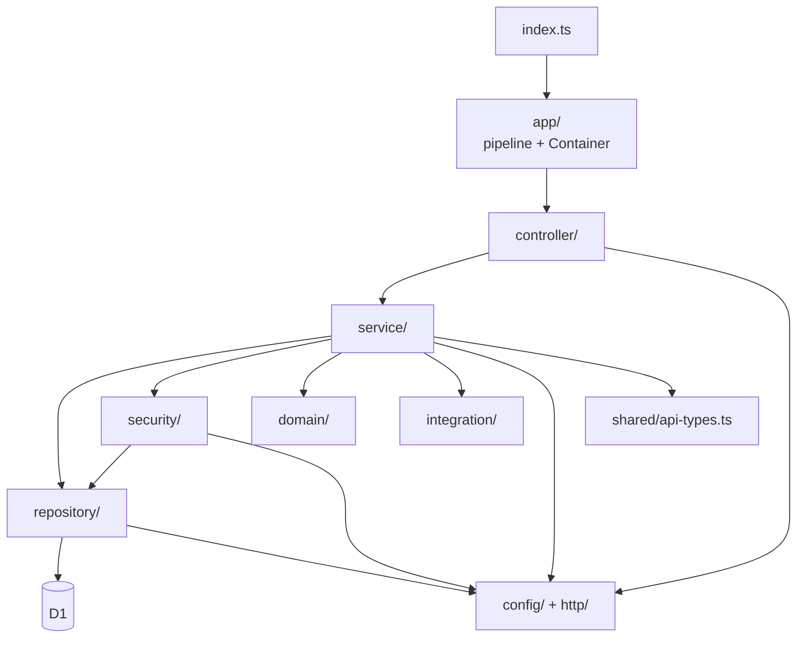
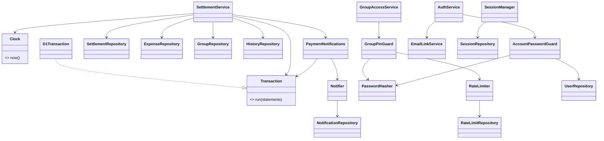
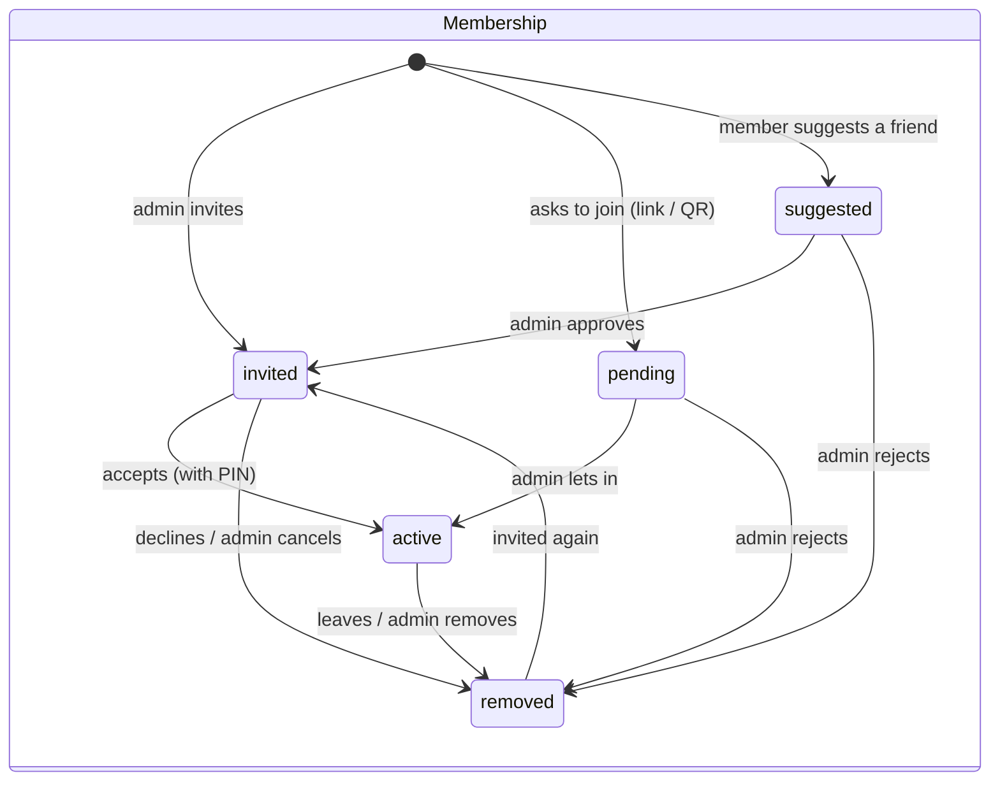
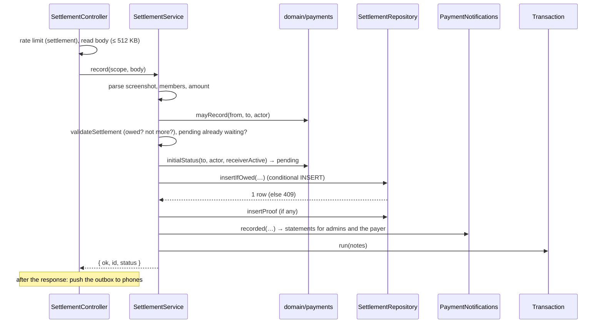

# Split It: low-level design (LLD)

How the system in [HLD.md](HLD.md) is built: code structure, request handling, every module's responsibility, the API, the schema, state machines and algorithms.

## 1. Conventions

- **Money** is integer paise (`*Cents`, `amount_cents`). Rupees appear only as input strings and display values.
- **Ids** are UUIDs. A person's id is the same in every group and never changes.
- **Time** is milliseconds since the epoch, read through the injected `Clock`.
- **Errors:** services throw `ApiError(message, status, extra)`, and the handler answers `{ "error": message, ...extra }`.
- **Request input** is `Untrusted<fields>`: every field `unknown` until checked.

## 2. Code structure

```
src/
  index.ts            Worker entry: fetch (API + static app), scheduled (cleanup)
  app/                SplitItApplication (request pipeline), Container (dependency injection)
  controller/         routes → services; reads requests, applies rate limits
  service/            business rules, one area per class
  repository/         all SQL; Transaction
  security/           passwords, sessions, rate limits, Google, group PINs
  domain/             pure rules: money, splits, debts, payment rules, text, input types
  integration/        email (Brevo), phone push (Web Push)
  http/               Router, RequestContext, ApiError, responses
  config/             constants, Env, Clock
shared/api-types.ts   API answer types (used by services and the React app)
web/src/              React app: features/*, hooks/queries.ts, lib/api.ts, …
migrations/           numbered SQL migrations
tests/                unit, API, migration, golden master; e2e/ browser test
```

**Dependency rule:** each layer uses only the layers below it. Nothing imports controllers except `app/`.



## 3. Request pipeline

`index.ts` handles `OPTIONS` (CORS preflight) and refuses cross-site writes (an `Origin` that isn't this site gets 403). It builds a `RequestContext` and calls `handleApi`, which runs these stages in order. The first stage that answers wins.

| # | Stage | Router / class | Fails with |
|---|---|---|---|
| 1 | Public routes (sign-up, sign-in, email links, `/api/me`, logout) | `publicRoutes` (`AuthController`) | — |
| 2 | Requests from app versions before accounts | path check | 410 `app_updated` |
| 3 | Signed in? | `SessionManager.currentUser` | 401 |
| 4 | Site owner console (`/api/site-admin/*`) | `SiteAdminController.handle` | 404 (hidden), 403 `admin_locked` |
| 5 | Signed-in routes | `signedInRoutes` (Me, Group, Invitation, Insights, Settlement, PaymentMethod, Notification, Friend) | — |
| 6a | Group member? (`/api/groups/:id/…`) | `GroupAccessService.open` | 404 |
| 6b | `POST unlock` (allowed while locked) | `GroupAccessService.unlock` | 400 / 401 / 429 |
| 6c | Opened with its PIN on this device? | `GroupAccessService.requireUnlocked` | 423 `group_locked` |
| 6d | Group routes, matched on the path after `/api/groups/:id/` | `groupRoutes` | — |
| 7 | Nothing matched | — | 404 |

After the response, the request's outbox (every notification written) is pushed to phones (`sendPushes`), via `ctx.waitUntil` in production. Errors go through `errorResponse`: an `ApiError` becomes its own status and body; anything else becomes a logged 500 (with details only in development).

**Controller context types** narrow as a request gets further (interface segregation):

```ts
type Web     = { http: RequestContext; app: Container };
type Authed  = Web & { user: CurrentUser };
type InGroup = Authed & { scope: GroupScope };   // gid, user, role, isAdmin, name, pinHash
```

**Router.** An ordered list of `(method | "*", pattern, handler)`. String patterns are exact and anchored; regex groups become `params`. The first match wins. `dispatch` returns `null` when nothing matches, so the pipeline moves to its next stage.

## 4. Composition (dependency injection)

`Container` is built per request, because the environment (secrets, feature switches) is read per request. It creates each object once and passes in what it depends on through its constructor. No class creates its own dependencies.



## 5. Modules

### 5.1 Controllers (`src/controller/`)

| Controller | Routes |
|---|---|
| `AuthController` | `/api/auth/*`, `GET /api/me`, `POST /api/logout` |
| `MeController` | `/api/me/profile`, `name`, `email/verify`, `google`, `google/disconnect`, `password` (`pin`), `link` |
| `GroupController` | `GET/POST /api/groups`; in a group: `GET ""`, `pin`, `leave`, `rename`, `delete` |
| `InvitationController` | `/api/invitations`, `/api/groups/:id/invitation/(accept|decline)`, `/api/join/:code`; in a group: `invite-link(/reset|/off)` |
| `MemberController` | in a group: `members/invite`, `members/:id/(approve|reject|remove|cancel-invite|make-admin|make-member)` |
| `ExpenseController` | in a group: `expenses` (GET/POST), `expenses/:id/edit`, `expenses/:id/delete`, `history` |
| `SettlementController` | `/api/payments/pending`; in a group: `settlements` (GET/POST), `settlements/mine`, `debts`, `settlements/:id/proof`, `settlements/:id/(confirm|reject|cancel)` |
| `InsightsController` | `/api/balances`; in a group: `balances`, `dashboard`, `members/:id`, `members/:id/statement`, `with/:id`, `pair/:a/:b` |
| `PaymentMethodController` | `/api/payment-method` (GET/POST), `/qr`, `/delete`; in a group: `payment-methods`, `members/:id/qr` |
| `NotificationController` | `/api/notifications` (GET), `/read`; `/api/push/key`, `/subscribe`, `/unsubscribe` |
| `FriendController` | `/api/friends`, `/request`, `/:id/(accept|decline|remove)` |
| `SiteAdminController` | `/api/site-admin/unlock`, `lock`, `overview`, `users`, `groups`, `groups/:id/reset-pin` |

**A controller method does three things, in this order:**
1. applies the route's rate limit;
2. reads the body (only when needed, so size limits and parsing apply only then);
3. calls one service method and wraps the result with `json(result, status)`.

It contains no business rules.

### 5.2 Services (`src/service/`)

| Service | Responsibility | Methods |
|---|---|---|
| `AuthService` | Proving who you are | `signUp`, `usernameAvailability`, `signIn`, `legacySignIn`, `forgot`, `resetLink`, `reset`, `verifyEmail`, `google` |
| `AccountService` | My own account | `updateProfile`, `rename`, `sendEmailConfirmation`, `connectGoogle`, `disconnectGoogle`, `changePassword`, `linkOtherAccount` |
| `EmailLinkService` | One-time email links | `send`, `sendQuietly`, `find` |
| `GroupService` | A group's lifecycle | `create`, `listMine`, `detail`, `leave`, `rename`, `delete` |
| `GroupAccessService` | Membership and PIN lock | `open`, `requireUnlocked`, `unlock`, `setPin` |
| `InvitationService` | Getting into a group | `invitations`, `acceptInvitation`, `declineInvitation`, `joinLink`, `join`, `inviteLink`, `changeInviteLink` |
| `MembershipService` | Who is in a group | `invite`, `manage` |
| `ExpenseService` | Expenses and their history | `parse`, `add`, `edit`, `delete`, `list`, `history` |
| `SettlementService` | The payment flow | `list`, `debts`, `record`, `proof`, `decide`, `pendingForMe` |
| `PaymentNotifications` | Who hears about a payment, and the wording | `recorded`, `confirmed`, `rejected`, `cancelled` |
| `InsightsService` | Read-only views | `home`, `balances`, `dashboard`, `member`, `pair`, `statement` |
| `PaymentMethodService` | UPI details | `mine`, `save`, `myQr`, `remove`, `inGroup`, `memberQr` |
| `FriendService` | Friends | `list`, `request`, `act` |
| `NotificationService` | The bell and phones | `list`, `markAllRead`, `pushKey`, `subscribe`, `unsubscribe` |
| `Notifier` | Writing one notification (and queueing its push) | `stmt`, `expenseStmts` |
| `SiteAdminService` | The site owner console | `mayTryKey`, `unlock`, `lock`, `overview`, `users`, `groupList`, `resetGroupPin` |

**How services are written:**
- They take `CurrentUser` or `GroupScope` plus typed input, and return objects typed by `shared/api-types.ts`.
- Writes that belong together go through `Transaction.run([...statements])`.
- Where reading the body depends on an earlier check (for example, the PIN is read only for groups that have one), the service receives a callback `() => Promise<…>` instead of the value.

### 5.3 Security (`src/security/`)

| Class | Responsibility |
|---|---|
| `PasswordHasher` | `pbkdf2-sha256$<iterations>$<salt hex>$<hash hex>` with the `SESSION_SECRET` pepper; constant-time compare |
| `AccountPasswordGuard` | Password check with lockout (5 failures lock the account for 15 minutes); first-password creation for old accounts; the old admin's one-time switch from the admin key to a password |
| `SessionManager` | `currentUser` from the cookie (deleting expired sessions); `start` (a random token of two UUIDs, about 244 random bits; only its SHA-256 hash stored; 7-day HttpOnly cookie); `end` |
| `GroupPinGuard` | PIN check (only wrong PINs count; 5 per 15 minutes per person per group); remembers an unlock for a day |
| `RateLimiter` | Fixed windows over `RateLimitRepository`: `limited` (counts an attempt), `check` (counts and refuses with 429), `count` (no increment). Fails open if the table is missing |
| `GoogleTokenVerifier` | RS256 signature against Google's JWKS (cached per instance), then issuer, audience, expiry and verified email |
| `crypto.ts`, `passwords.ts` | SHA-256, ids and URL tokens; password policy (8–128 characters, letters and digits) |

### 5.4 Domain (`src/domain/`): pure functions, no I/O

| Module | Contents |
|---|---|
| `money.ts` | `parseAmountToCents` (no floats; at most 2 decimals; ≤ ₹10 crore), `rupees`, `inrText` |
| `split.ts` | `allocateEqualSplit`, `allocateManualSplit` |
| `settlement.ts` | `computeBalances`, `computePairwiseDebts`, `outstandingDebt`, `debtsForMember`, `validateSettlement`, `pairwiseActivity` |
| `payments.ts` | `PaymentStatus`, `needsAdminApproval`, `canDecide`, `canCancel`, `mayCancel`, `decisionRefusal`, `awaitsDecisionBy`, `mayRecord`, `mayRecordDebt`, `initialStatus` |
| `text.ts` | `cleanName`, `normUsername`, `normEmail`, `textField`, `isEmailLogin`, `loginKind` |
| `members.ts` | `nameLookup` (unknown ids show as "Former member") |
| `input.ts` | `Untrusted<fields>` |

### 5.5 Repositories (`src/repository/`)

Each repository owns the SQL for its tables. Methods ending in `Stmt` return a statement to put in a transaction; the others run immediately.

| Repository | Tables |
|---|---|
| `UserRepository` | `appx_users` |
| `SessionRepository` | `appx_user_sessions`, `appx_group_unlocks` |
| `GroupRepository` | `appx_groups`, `appx_group_members` (and deleting a whole group) |
| `ExpenseRepository` | `appx_expenses`, `appx_splits`; the group ledger |
| `SettlementRepository` | `appx_settlements`, `appx_payment_proofs`; `owedSql` |
| `HistoryRepository` | `appx_history` |
| `NotificationRepository` | `appx_notifications` |
| `PaymentMethodRepository` | `appx_payment_methods` |
| `FriendshipRepository` | `appx_friendships` |
| `EmailTokenRepository` | `appx_email_tokens` |
| `PushSubscriptionRepository` | `appx_push_subscriptions` |
| `RateLimitRepository` | `appx_rate_limits` |
| `SiteAdminRepository` | Read-only summaries |
| `AccountMergeRepository` | Moving one account's rows into another |
| `HousekeepingRepository` | The daily cleanup |
| `Transaction` / `D1Transaction` | Atomic batches |

### 5.6 Integrations (`src/integration/`)

- **`email.ts`:** builds a link email (HTML and text) and sends it through Brevo. It is on only when `BREVO_API_KEY` and `EMAIL_FROM` are set.
- **`push.ts`:**
  - accepts only real push-service endpoints (`validSubscription`);
  - encrypts with aes128gcm (RFC 8291) and signs with VAPID ES256 (RFC 8292);
  - deletes subscriptions that answer 404/410;
  - is on only when the VAPID keys are set.

## 6. API

All bodies are JSON. "Signed in" routes need the `split_user` cookie. "In group" routes are under `/api/groups/:id/` and also need active membership and the PIN unlock.

| Method and path | Access | Returns (`shared/api-types.ts`) |
|---|---|---|
| `POST /api/auth/signup` | public | `{ ok, id }` + cookie, 201 |
| `GET /api/auth/username?u=` | public | `{ username, valid, available }` |
| `POST /api/auth/signin`, `/legacy-signin` | public | `{ ok, id, legacy }` + cookie |
| `GET /api/auth/config` | public | `{ googleClientId, emailEnabled }` |
| `POST /api/auth/forgot` | public | `{ ok, message }` (the same whether or not the account exists) |
| `GET /api/auth/reset/:token`, `POST /api/auth/reset` | public | link check; new password + cookie |
| `POST /api/auth/verify-email` | public | `{ ok, email }` |
| `POST /api/auth/google` | public | `{ ok, id, created }` + cookie |
| `GET /api/me`, `POST /api/logout` | public | `Me`; clears the cookie |
| `POST /api/me/profile`, `/name`, `/password`, `/link`, `/google`, `/google/disconnect`, `/email/verify` | signed in | `Me` or `{ ok }` |
| `GET/POST /api/groups` | signed in | `{ groups: GroupSummary[] }`; `{ group }` 201 |
| `GET /api/invitations`, `POST /api/groups/:id/invitation/(accept|decline)` | signed in | `{ invitations: Invitation[] }`; `{ ok }` |
| `GET/POST /api/join/:code` | signed in | `JoinInfo`; `{ ok, groupId, status }` |
| `GET /api/balances` | signed in | `PeopleBalances` |
| `GET /api/payments/pending` | signed in | `{ toConfirm, waiting: PendingPayment[] }` |
| `GET/POST /api/payment-method`, `GET …/qr`, `POST …/delete` | signed in | `{ method: PaymentMethod }`; image |
| `GET /api/notifications`, `POST …/read` | signed in | `{ items: AppNotification[], unread }` |
| `GET /api/push/key`, `POST /api/push/subscribe`, `/unsubscribe` | signed in | `{ publicKey }`; `{ ok }` |
| `GET /api/friends`, `POST …/request`, `POST …/:id/(accept|decline|remove)` | signed in | `Friends`; `{ ok, status, name }` |
| `POST unlock` | member (allowed while locked) | `{ ok }` |
| `GET ""` | in group | `GroupDetail` |
| `POST pin`, `rename`, `delete` | in group, admin | `{ ok }` |
| `POST leave` | in group | `{ ok }` |
| `GET/POST invite-link`, `POST invite-link/(reset|off)` | in group (admin to change) | `{ code, canManage }` |
| `POST members/invite` | in group (members suggest friends) | `{ ok, status, name }` |
| `POST members/:id/<action>` | in group, admin | `{ ok }` |
| `GET/POST expenses`, `POST expenses/:id/(edit|delete)` | in group (payer or admin to change) | `{ expenses: Expense[] }`; `{ ok, id, … }` |
| `GET history[?expense=]` | in group | `{ history: HistoryEntry[] }` |
| `GET settlements`, `settlements/mine`, `debts` | in group | `{ settlements: Settlement[] }`; `Mine`; `Debts` |
| `POST settlements` | in group | `{ ok, id, amountCents, status }` 201 |
| `POST settlements/:id/(confirm|reject|cancel)` | in group (per the payment rules) | `{ ok, status }` / `{ ok, cancelled }` |
| `GET settlements/:id/proof`, `members/:id/qr` | in group | image |
| `GET balances`, `dashboard`, `members/:id`, `members/:id/statement`, `with/:id`, `pair/:a/:b`, `payment-methods` | in group | `{ balances }`, `Dashboard`, `MemberSummary`, `Statement`, `PersonView`, `{ people }` |
| `/api/site-admin/*` | site owner with the admin key | `AdminOverview`, `{ users }`, `{ groups }`, `{ ok }` |

**Status codes:**

| Code | Meaning |
|---|---|
| 400 | Invalid input |
| 401 | Not signed in, or a wrong password or PIN |
| 403 | Not allowed |
| 404 | Not found, or not visible to you |
| 409 | Conflicts with the current state |
| 410 | An expired link, or an app version from before accounts |
| 413 | Body too large: 16 KB, or 512 KB with an image |
| 423 | Group locked |
| 429 | Rate-limited or locked out |
| 502 / 503 | Email or Google unreachable, or not set up |

## 7. Database

| Table | Key | Columns | Notes |
|---|---|---|---|
| `appx_users` | `id` | username, display_name, email, google_sub, pin_hash, pin_failures, pin_locked_until, legacy, site_role, email_verified_at, created_at | unique username; unique email and google_sub when set |
| `appx_user_sessions` | `token_hash` | user_id, expires_at, admin_until | index on user_id |
| `appx_groups` | `id` | name, created_by, pin_hash, invite_code, created_at | unique invite_code when set |
| `appx_group_members` | `(group_id, member_id)` | name, role (admin\|member), status, joined_at, invited_by | FK to group; index on member_id |
| `appx_group_unlocks` | `(session_hash, group_id)` | until | |
| `appx_expenses` | `id` | group_id, description, amount_cents, paid_by, created_by, created_at | FK to group; index on (group_id, created_at) |
| `appx_splits` | `(expense_id, member_id)` | amount_cents | FK to expense, deleted with it |
| `appx_settlements` | `id` | group_id, from_member_id, to_member_id, amount_cents, status, created_by, created_at, decided_by, decided_at | FK to group; amount > 0; indexes on (group, created_at), (group, from, to), (group, status) |
| `appx_payment_proofs` | `settlement_id` | mime, base64, created_at | kept apart so lists never load images |
| `appx_history` | `id` | group_id, entity, entity_id, action, actor_id, before_json, after_json, created_at | indexes on (group, entity, entity_id, created_at), (group, created_at) |
| `appx_notifications` | `id` | recipient_id, group_id, kind, title, body, link, actor_name, created_at, read_at | index on (recipient, created_at) |
| `appx_payment_methods` | `(member_id, kind)` | upi_id, qr_mime, qr_base64, updated_at | |
| `appx_friendships` | `(user_a, user_b)` with `user_a < user_b` | requested_by, status, created_at | index on user_b |
| `appx_email_tokens` | `token_hash` | user_id, purpose, email, expires_at, used_at | |
| `appx_push_subscriptions` | `endpoint` | member_id, p256dh, auth, created_at | at most 10 per person |
| `appx_rate_limits` | `bucket` | window_start, count | |
| `appx_settings` | `setting_key` | setting_value | old settings |

**Triggers:**
- Person ids in memberships, expenses (`paid_by`), splits and payments must exist in `appx_users`, checked on insert and update.
- A changed `display_name` is copied into every membership.

**Migrations:** `migrations/NNNN_name.sql`, applied in name order and once each. `0003` and `0004` were used twice early on; a test refuses any new duplicate.

## 8. State machines

```mermaid
stateDiagram-v2
  direction LR
  [*] --> pending: recorded
  [*] --> confirmed: an admin records money they received, or a payment to someone who left
  pending --> confirmed: receiver confirms (admin, if "they paid me"), and it still fits what is owed
  pending --> rejected: receiver / admin rejects
  pending --> [*]: cancelled (deleted; kept in history)
```





**Friendships:** none → `pending` (someone asks) → `accepted` (the other person accepts, or asks back). Declining, cancelling or removing deletes the row.

## 9. Algorithms

**Equal split.** `base = floor(total / n)`; the first `total mod n` members get one paisa more. Duplicate ids count once, and zero shares are dropped. Shares always add up to the total, or the request fails.

**Debts (direct attribution).** For each expense, every split member except the payer owes their share to the payer. Edges are summed per (debtor, creditor). Confirmed payments are subtracted from the same direction, then opposite directions are netted:

```
owes(a→b) = Σ shares a has in b's expenses − Σ shares b has in a's expenses
          − Σ confirmed payments a→b + Σ confirmed payments b→a      (shown when > 0)
balance(m) = paid(m) − shares(m) + payments made(m) − payments received(m)
```

Balances in a group always sum to zero. The same ledger feeds every screen, so they always agree.

**No overpaying (in SQL).**
- Recording inserts `… SELECT … WHERE amount <= owedSql(group, from, to, reserve = true)`, where `reserve` also subtracts payments still pending.
- Confirming updates `… WHERE status = 'pending' AND amount <= owedSql(…)`.
- Zero rows changed means 409.

**Pair statement.** The pair's expenses and confirmed payments are sorted by time, then id, with a running balance after each. Pending and rejected payments are listed with effect 0. Each expense also carries a cumulative share for the person.

**Rate limit.** `bucket = scope:key`, `window = now − now mod windowMs`. An upsert increments the count, or resets it to 1 in a new window. The request is limited when the count exceeds the limit.

| Scope | Limit |
|---|---|
| Sign-in | 20 per 15 min per IP |
| Sign-up | 10 per hour per IP |
| Forgot password | 10 per hour per IP, and 3 per hour per account |
| Expenses | 60 per 10 min |
| Payments | 30 per 10 min |
| Invites and friend requests | 40 per 10 min |
| Groups | 20 per 10 min |
| Profile and payment method | 20 per 10 min |
| Admin key | 10 per 15 min, per account and per IP |

**History snapshot.** `{ description, amountCents, paidBy, splits: [{ memberId, amountCents }] }` for expenses, and `{ fromMemberId, toMemberId, amountCents, createdBy, createdAt }` for payments. Names are added when the history is read.

## 10. Key sequences

**Recording "they paid me".**



**Editing an expense:** rate limit → find the expense (404) → payer or admin (403) → read and parse the body → old splits → one transaction: history entry (before and after), notifications (including people removed from the split), update, delete the old splits, insert the new splits.

**Opening a locked group:** `open` (membership, name and PIN) → `POST unlock` → `GroupPinGuard.check` (count, format, compare, count a failure) → one transaction: remember the unlock for this session, delete expired unlocks.

## 11. Frontend (`web/src/`)

| Part | Role |
|---|---|
| `lib/api.ts` | `get` / `post` with the cookie; error type with status, code and body; re-exports the shared API types |
| `hooks/queries.ts` | TanStack Query hooks per API read; mutations invalidate the group's queries (`["group", id]`) |
| `lib/route.ts` | Hash router: `#/`, `#/g/:id[/e/:expense]`, `#/g/:id/p/:person`, `#/join/:code`, `#/reset/:token`, `#/verify-email/:token`, profile, friends, admin |
| `features/*` | Screens: auth, groups (expenses, balances, payments, insights, members, settings, history), invites, friends, notifications, profile, site admin |
| `lib/xlsx.ts`, `features/groups/statementExcel.ts` | Builds the Excel statement in the browser (lazy-loaded) |
| `lib/update.ts`, `public/sw.js` | New-version check; service worker (shell cache, push, refresh message) |
| `GroupGate`, the 423 handler | Ask for the group PIN when the API answers `group_locked` |

## 12. Testing

| Suite | Location | Technique |
|---|---|---|
| Unit | `tests/*.test.js` (money, split, settlement logic, payment rules, text, router, notifications, password guard) | Pure functions, or classes with fakes (`Transaction`, `Clock`, repositories) |
| API | `tests/*.api.test.js` | The real Worker against `node:sqlite` with all migrations (`tests/helpers/d1.js`) |
| Golden master | `tests/golden/` | Fixed clock, ids and randomness; 416 requests; compares responses, emails, pushes and the database (`npm run golden:record` after an intended change) |
| Migrations | `tests/migrations.test.js`, `tests/legacy-migration.test.js` | Empty database; data written by the old Worker |
| Browser | `e2e/browser.e2e.mjs` | Playwright, Pixel 7 viewport, local `wrangler dev` |

## 13. Extending

**Adding an endpoint:**
1. Add the SQL as a repository method.
2. Add the rule as a service method, returning a type from `shared/api-types.ts` and taking `Untrusted<…>` input.
3. Add the controller method (rate limit → body → service → `json`) and register it in the controller's `register` or `registerInGroup`.
4. Wire any new class in `Container`.
5. Add an API test and, if it is a rule, a unit test.
6. Extend the golden scenario and re-record it.

**Changing the database:** add the next-numbered migration (additive; use `IF NOT EXISTS`), extend `tests/migrations.test.js`, and deploy with the usual command, which applies it first.

**Changing a rule:** change it in `domain/` (for example `payments.ts`). Every caller picks it up, and the unit tests pin it down.
