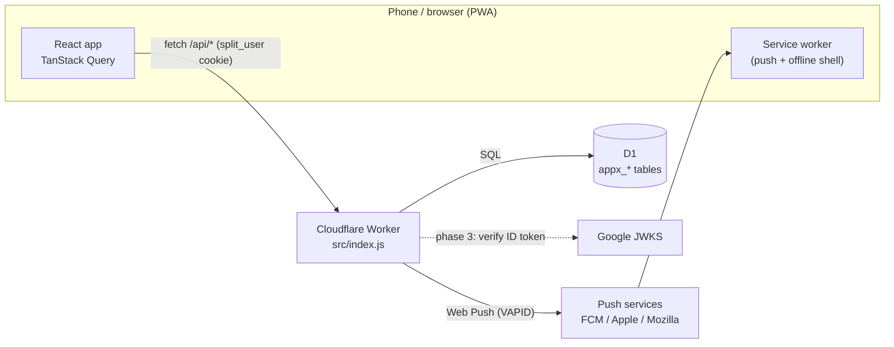
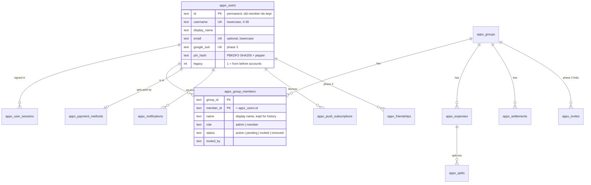
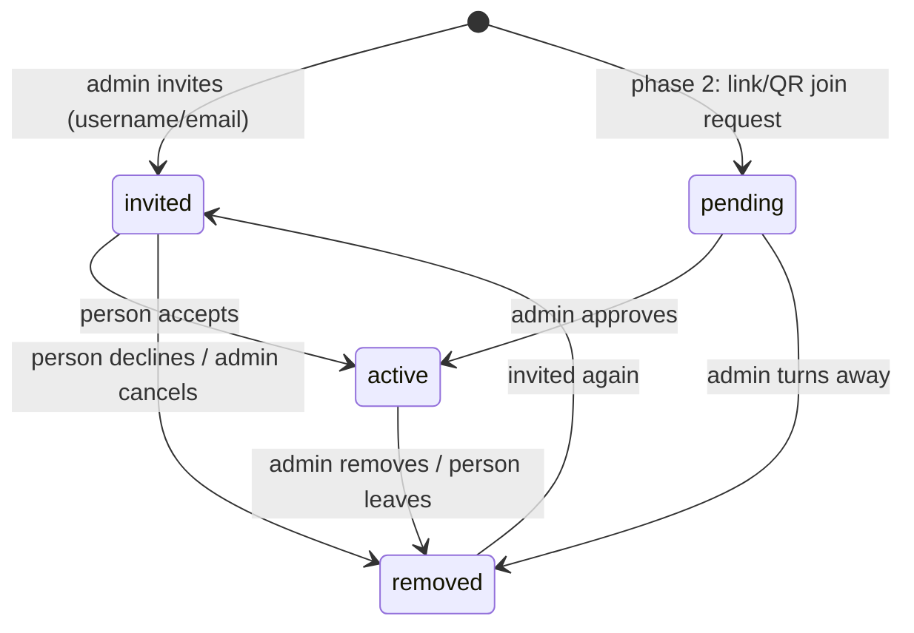

# Split It: accounts, groups for everyone, friends and Google sign-in

System design for turning Split It from "one administrator, members per group" into an app anyone can sign up for, create groups in and invite friends to. It is delivered in three pull requests, each usable on its own:

| Phase | What | Status |
|---|---|---|
| 1 | Accounts (username / email + PIN), profiles, groups for everyone, per-group admins, invite by username or email, moving existing data | **Built** (this PR) |
| 2 | Invite links and QR codes with admin approval, friends | Planned |
| 3 | Sign in with Google | Planned |

## 1. Goals

- **One account per person.** A person can be in any number of groups. Today the same person in two groups is two separate members with two PINs.
- **Sign in** with username, email or (phase 3) Google, plus a 4-digit PIN.
- **Anyone can create a group** and becomes its admin. Groups never see each other.
- **Admins are per group.** A group can have several admins; admins can make others admin. Everyone sees who the admins are, and you are marked "(you)".
- **Joining:**
  - an admin invites by username or email ("not found" if the person isn't on Split It);
  - (phase 2) a share link or QR code, which an admin must approve;
  - (phase 2) choosing from your friends.
- **Existing data keeps working.** Every balance, expense and payment stays exactly as it was, and everyone can still get in.

Non-goals for now: payment methods other than UPI, and email delivery. Invitations show up in the app and as notifications, not as emails.

## 2. Architecture

The architecture is unchanged: a single Cloudflare Worker (`src/index.js`) serves the JSON API and the React app (`web/`, built into `dist/`). Data lives in one D1 database. Money is kept in integer paise everywhere.



## 3. Data model



The key decision is that **a person's id never changes**. Expenses (`paid_by`, `created_by`), splits, payments, UPI details, notifications and push devices all point at that id. Migrated members keep their old member id as their account id, so none of those rows are touched.

Membership status:



`removed` rows are never deleted, so history keeps showing the person's name. Only `active` members can open the group, appear in pickers or be chosen in a split.

## 4. Authentication

| How | Endpoint | Notes |
|---|---|---|
| Sign up | `POST /api/auth/signup` | name, username, optional email, 4-digit PIN |
| Username or email + PIN | `POST /api/auth/signin` | `@vicky`, `Vicky` and `vicky@mail.com` all work |
| Existing members, once | `POST /api/auth/legacy-signin` | group name + their name + PIN; only for `legacy` accounts |
| Google (phase 3) | `POST /api/auth/google` | see §8 |

- **Sessions:** a random token in an `HttpOnly; Secure; SameSite=Lax` cookie (`split_user`). Only its SHA-256 hash is stored, in `appx_user_sessions`. Sessions last 30 days, and sign-out deletes them.
- **PINs:** stored as PBKDF2-SHA256 (100,000 iterations) with a per-account salt and `SESSION_SECRET` as a pepper. Five wrong PINs lock the account for 15 minutes, and there are per-IP rate limits on every sign-in path.
- **Old administrator:** their first sign-in uses the old `ADMIN_PIN` once, then they must choose a 4-digit PIN. After that, `ADMIN_PIN` is unused.

## 5. Groups and roles

What each person can do in a group:

| Action | Member | Admin |
|---|---|---|
| See the group, add expenses, settle up | ✓ | ✓ |
| Edit or delete an expense | only ones they paid | any |
| Confirm or reject a payment | ones sent to them | any |
| Invite (username/email), approve or turn away, cancel an invite | | ✓ |
| Make admin or regular, remove someone | | ✓ (at least one admin must remain) |
| Rename or delete the group | | ✓ |
| Leave | ✓ | ✓ (if another admin remains, or nobody else is left) |

**Isolation:** every `/api/groups/:id/*` route first checks that the caller is an `active` member of that group, and anything else gets 404. There is no public group list. Being admin of one group gives no rights in another; tests cover both.

## 5a. Site owner ("Admin" tab)

The site owner's role is separate from group admins.

**Who the owner is**

- The owner is one account with `appx_users.site_role = 'admin'` (migration `0014`).
- On existing data, that is the old administrator's account.
- On a fresh install, the first account to enter the admin key at `#/admin` becomes the owner. After that, the key does nothing for anyone else.

**The two tabs**

- The owner's header shows **General | Admin**. Nobody else sees the switch, and `/api/me` doesn't mention it to them.
- **General** is the owner's ordinary account: only the groups they are in, with exactly the rights anyone has.
- **Admin** is the console:
  - totals (people, new this week, groups, expenses, money recorded);
  - **People**: search, groups count, locked or no-PIN flags, **Reset PIN**;
  - **Groups**: members, admins, expense count, total, last activity.
- The two tabs don't share anything. The console never shows anyone's expenses, and General never gets console powers.

**Unlocking and access**

- **Key per session:** opening Admin needs the admin key (the `ADMIN_PIN` secret) once per session, for 12 hours. **Lock** ends it.
- **Unlock limits:** unlocking is rate-limited per account and per IP.
- **Everyone else:** every `/api/site-admin/*` route answers 404 for non-owners.

**Reset PIN**

- Reset PIN covers forgotten PINs. It sets a random temporary 4-digit PIN, shown once to the owner to pass on, and signs the person out everywhere.

## 6. Moving existing data (migration `0013_accounts.sql`)

The migration only adds tables and columns, plus one index drop: group names no longer need to be unique. It changes no money rows. It does the following:

1. **Accounts.**
   - Every old member (`appx_access_requests`) becomes an account with the same id, name, PIN hash and lock state.
   - Each gets the username `name_xxxxxx`, or `user_xxxxxx` when the name has emoji or other symbols, and `legacy = 1`.
2. **Old administrator.** Becomes account `admin`, with no PIN yet, and is `admin` of every group they were in.
3. **Membership states.**
   - Approved members → `active`.
   - Revoked, rejected or deleted members → `removed`.
   - Waiting for approval → `pending`.
4. **Old tables.** The old tables are left in place and are no longer read.

How existing people get in:

- **Members:** sign in once with "Used Split It before? Sign in with your group". Then they pick a username in their profile, or keep the suggested one.
- **The administrator:** the same form, with the old admin PIN, then they choose a new PIN.

**Two accounts, one person:** "Had another account?" in Profile links them (`POST /api/me/link`, after proving the other account's PIN):

- Shares on the same expense are added together.
- Payments between the two accounts are dropped (they were to oneself).
- Everything else moves across, and every other person's balance is unchanged.

### How this is tested

- **`tests/legacy-migration.test.js`** uses a frozen copy of the previous Worker (`tests/fixtures/legacy/`) to create a database through the old API:
  - admin; approved, removed, pending and pre-PIN members;
  - an emoji name, and the same person in two groups;
  - equal and exact splits;
  - confirmed, pending (with screenshot) and rejected payments;
  - UPI details and notifications.

  It records what the old app showed, applies the migration, and asserts that the new Worker shows **exactly the same** balances, debts, expenses, payments and dashboards. It also checks that every kind of person can sign in, and that linking keeps balances.

  Deliberately breaking the migration makes these tests fail.
- **On real local D1** (`wrangler d1 migrations apply --local`): the same check passed. The old Worker ran on migrations 0001–0012 and created data, 0013 was applied, the new Worker ran, and its snapshots were identical.
- **Merge properties:** 15 randomised property tests check that linking accounts keeps balances zero-sum and leaves everyone else's balance unchanged.
- **Browser E2E:** sign up, create a group, invite (including not found), accept, roles, profile, settle up and the rest of the existing journey.

### Rollout

1. Back up D1: `npx wrangler d1 export split_expense_db --remote --output backup.sql`.
2. Paste `0013_accounts.sql` in the D1 console and record it in `d1_migrations`. The old app keeps working with the new columns, so you can do this first.
3. Merge the PR. Everyone is signed out once (new cookie) and signs in with their group, or with the new form.
4. Rollback: the old tables are untouched. Redeploying the previous version works, but accounts and groups created after the switch would not be visible to it.

## 7. Phase 2: invite links, QR codes and friends

**Invite links and QR codes**

- Each group gets a join link: `https://…/#/join/<code>`. The code is 128-bit random, and only its hash is stored, in `appx_invites` (the table already exists).
- An admin can turn the link off or replace it. Optionally it expires.
- The QR code is generated in the browser from the same link. "Show QR" lives in the group's members sheet. "Scan to join" on Home uses the camera with `BarcodeDetector` where available, falling back to a small JS decoder (e.g. jsQR).
- Opening the link while signed in shows the group's name and member count, and offers **Ask to join**. That creates a `pending` membership, notifies the group's admins, and an admin approves it, as the request said.
- If the person isn't signed in, they sign up or sign in first, then continue.

**Friends**

- New table `appx_friendships(user_a, user_b, status, requested_by, created_at)`. The pair is stored ordered (a < b) and unique.
- Status is `pending` or `accepted`. Requests are made by username or email, with "not found" when there is no such account, and the other person accepts or declines.
- In a group, people who aren't your friends show an **Add friend** button.
- An admin's invite form lists their friends to pick from. Inviting a friend works like inviting by username.
- A non-admin member can *suggest* a friend. That creates a `pending` row which an admin approves, so nobody joins without an admin.

**Privacy**

- Search only matches an exact username or email; there is no browsing of users.
- Usernames and emails are already rate-limited at the invite endpoint. The same limits will apply to friend requests.

## 8. Phase 3: Sign in with Google

- **Client:** Google Identity Services ("Sign in with Google" button, One Tap on Android). It returns an **ID token** (a JWT). No Google client secret is needed, and no redirect flow.
- **Server:** `POST /api/auth/google { credential }`. The Worker verifies the RS256 signature against Google's JWKS (fetched and cached), plus `iss`, `aud = GOOGLE_CLIENT_ID`, `exp` and `email_verified`.
- **Account matching:**
  - If `google_sub` is known, sign in.
  - If it is new and the email isn't on another account, create an account (name from Google, a suggested username to confirm, no PIN needed).
  - If the email already belongs to an account without Google, **don't auto-link**: emails aren't verified on PIN accounts. Ask the person to sign in with their PIN once, then use "Connect Google" in Profile.
- **Forgotten PIN:** Google sign-in also covers this. Once Google is connected, the person can sign in with Google and set a new PIN.
- **Configuration:** a `GOOGLE_CLIENT_ID` variable (an OAuth client of type "Web application" in Google Cloud Console, with the site's origin allowed).

## 9. API summary (phase 1)

```
POST /api/auth/signup            {name, username, email?, pin}
POST /api/auth/signin            {login, pin, createPin?|newPin?}
POST /api/auth/legacy-signin     {group, name, pin, createPin?|newPin?}
GET  /api/auth/username?u=       -> {valid, available}
GET  /api/me                     -> {user|null}
POST /api/logout
POST /api/me/profile             {name?, username?, email?}
POST /api/me/pin                 {currentPin, newPin}
POST /api/me/link                {login | group+name, pin}
POST /api/groups                 {name}            -> creator is admin
GET  /api/groups                 -> my active groups with role
GET  /api/invitations            -> groups I'm invited to
POST /api/groups/:id/invitation/accept|decline
POST /api/groups/:id/members/invite              {login}  (admin)
POST /api/groups/:id/members/:mid/approve|reject|cancel-invite|remove|make-admin|make-member (admin)
POST /api/groups/:id/rename|delete              (admin)
POST /api/groups/:id/leave
```

Every other group endpoint (expenses, balances, payments, UPI, screenshots, notifications, push) is unchanged. The only difference is that "admin" now means admin *of that group*.

## 10. Risks and trade-offs

- **Unverified emails.** Email is used to find people and to sign in, but it isn't verified until phase 3. Someone could put another person's email on their account. Mitigations:
  - emails are unique, so the real owner would see "already used";
  - Google never auto-links to an unverified email.

  Email verification (a magic link) can be added later.
- **Finding out who has an account.** Anyone can create a group and try usernames or emails to see whether someone is on Split It. The product asks for "not found", so this is accepted, but it is rate-limited.
- **Same display name.** Two different people may share a name in a group, and their `@username` tells them apart.
- **Forgotten PIN.** Until phase 3 there is no self-service reset: the site owner resets it from the Admin tab (a temporary PIN they pass on).
- **One-time sign-in for old members.** Until a member picks a username, anyone who knows their group and name can try their PIN. This is the same exposure as before, with the same lockout. Members who never had a PIN can have it set by whoever signs in first, as before.
